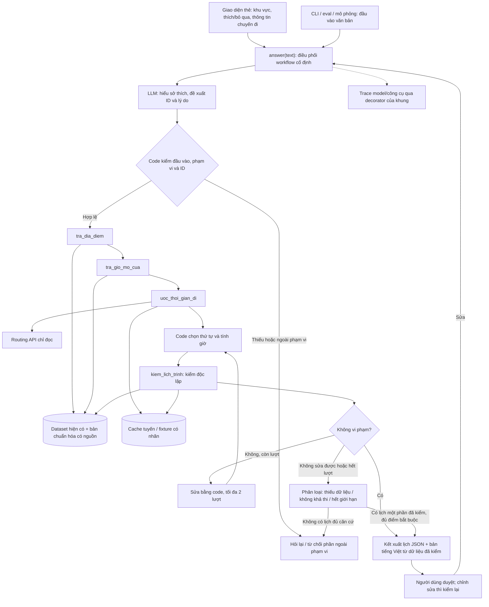

# TripSwipe — Kiến trúc giải pháp

> Bản thiết kế CP2 · 27/11/2026 · Phạm vi Hà Nội, một ngày.
> Cập nhật backend B1–B3 ngày 28/11/2026 ở mục 1.1. Mục 2–15 giữ bản thiết kế CP2 để đối chiếu, chưa phải mô tả toàn bộ code hiện hành; đồng bộ toàn bộ X4 còn chờ B4. Thiết kế nghiệp vụ hiện hành: [PRD.md](PRD.md), [spec.md §4](../spec.md). Hợp đồng HTTP đã triển khai: [api-examples.md](api-examples.md).

## 1. Hiện trạng và quyết định kiến trúc

Lõi `codebase/` dùng Python và thư viện chuẩn, `answer(text)` làm điểm vào chung của CLI/eval/mô phỏng. Đã có workflow đọc yêu cầu bằng model, bốn công cụ, `planner.plan`/`planner.check`, nối model thật và trace. Backend mới nằm độc lập trong `app/`, không làm CLI/eval phụ thuộc FastAPI hay Postgres. Giao diện quẹt và API lịch nhóm B4 chưa được triển khai ở nhánh công việc B1–B3.

Dữ liệu hiện có: [data/hanoi_places.json](../data/hanoi_places.json) gồm 119 POI và [data/travel_times.json](../data/travel_times.json) là ma trận tính sẵn. `codebase/places.py` giải giờ theo ngày/thứ/mùa và chuẩn hóa thời gian tuyến ước tính. Backend nạp JSON gốc vào Postgres bằng upsert, tái sử dụng hàm giờ của lõi để lọc bộ thẻ.

**Chọn workflow cố định**, với LLM ở bước hiểu yêu cầu và đề xuất điểm. Code kiểm ID, tính toán lịch, sửa và xác nhận ràng buộc. Không cần multi-agent hay vòng lặp model tự chọn công cụ: chuỗi công việc và điểm kiểm đã biết trước, cần chi phí và kết quả dễ truy vết.

### 1.1. Backend B1–B3 đã triển khai

| Module/tệp | Trách nhiệm thực tế |
|---|---|
| `app/main.py` | FastAPI lifespan, kết nối mỗi request, API cấu hình/nhóm/chi tiết/deck/quẹt/hoàn tác/tiến độ; `/health`, `/docs`, trang giới thiệu backend |
| `app/db.py` | Bảy bảng Postgres và ràng buộc; khóa startup khi nạp/upsert POI và ma trận, không xóa nhóm/phiếu |
| `app/schemas.py` | Kiểm ngày theo múi giờ Hà Nội, giờ cùng ngày, ngân sách, nickname, enum và boolean phiếu |
| `app/catalogue.py` | Adapter dữ liệu lõi, điểm xuất phát, lọc giờ/phạm vi/giá, cfg cho hàm `build_deck` sau này |
| `app/templates/`, `app/static/` | Nền phục vụ template/static cho UI; hiện chỉ có trang giới thiệu, chưa có wizard/quẹt |
| `Dockerfile`, `docker-compose.yml` | Python 3.12/FastAPI, Postgres 16, healthcheck/chờ DB khỏe, volume dữ liệu; web chỉ bind localhost |
| `tests/test_api.py`, `docker-compose-test.yml` | Test HTTP qua TestClient với Postgres thật, schema cô lập và xóa sau test; override mở cổng DB chỉ trên loopback |

Luồng HTTP: request → Pydantic → transaction Postgres → kiểm nhóm/thành viên → đọc/ghi → JSON. Tạo nhóm và trưởng nhóm là một transaction; biệt danh và cặp member/place có unique constraint. Các thao tác thay đổi dùng khóa dòng nhóm để tránh đua khi nhiều request cùng lúc. Nhóm/tiến độ không công khai member ID của người khác; ID cấp khi vào nhóm là capability thao tác demo localhost.

Bộ thẻ hiện dùng nhãn `provisional_rating`, lọc trước khi chọn tối đa 20 điểm; chưa gọi AI. `create_app(deck_builder=build_deck)` là điểm nối A3, kiểm dữ kiện và trả 502 nếu builder lỗi, không âm thầm fallback. Bộ thẻ đã tạo được giữ cố định; thành viên mới làm giảm budget/người thì ẩn thẻ vượt ngân sách nhưng giữ phiếu lịch sử. Progress chỉ tính thẻ hợp lệ hiện tại. Không triển khai thuật toán gộp phiếu hoặc endpoint itinerary của B4 trong phần này.

Dependency web ghi trong `requirements.txt`, dependency HTTP test trong `requirements-dev.txt`. Không sửa file khung BTC, bộ metric hoặc kết quả eval đã chạy. Chi tiết payload, mã lỗi và ví dụ: [api-examples.md](api-examples.md).

## 2. Sơ đồ tổng thể



Trước LLM, điều phối tải danh mục ID/thẻ ứng viên và dữ kiện chuyến đi. Sau bước gác ID, bốn công cụ lấy dữ kiện chi tiết cho đề xuất. Bộ kiểm dùng snapshot nguồn độc lập với nội dung model, không tin các trường giờ/giá do model trả về. Trace trong sơ đồ là cơ chế quan sát, không phải tác nhân lập lịch.

## 3. Công nghệ và lý do

| Thành phần | Lựa chọn thiết kế | Lý do và giới hạn |
|---|---|---|
| Điều phối, chuẩn hóa, tối ưu, kiểm lịch | Python 3.10+, thư viện chuẩn (`json`, `datetime`, `zoneinfo`, `itertools`, `math`) | Phù hợp khung BTC, bài toán nhỏ không cần dịch vụ solver riêng |
| Giao diện | HTML/CSS/JavaScript thuần, thẻ có nút bấm và thao tác quẹt; module app của nhóm phục vụ giao diện khi triển khai | Không cần thêm hệ framework. CLI tiếp tục dùng được để nộp/eval |
| HTTP nội bộ và gọi API | `http.server` cho demo cục bộ, `urllib.request` cho phía Python | Hạn chế phụ thuộc; không coi server demo là hạ tầng production |
| Lưu POI | JSON hiện có, nạp một lần, chỉ mục theo ID/tên/khu vực; CSV hỗ trợ nhập qua adapter khi có | Không thay dataset gốc; chưa cần cơ sở dữ liệu/vector database |
| Dữ liệu chuẩn hóa | Snapshot JSON phiên bản hóa do nhóm bổ sung sau, tách khỏi dữ liệu gốc | Đóng băng nguồn khi eval, tránh lịch thay đổi do cập nhật API |
| Model | Một LLM qua `call_model(system, user)`, nhà cung cấp cấu hình bằng môi trường | Chưa chốt model, giá hoặc SDK; mọi lời gọi giữ `@model_call`, usage thực |
| Tuyến | Adapter Routing API, ưu tiên đánh giá openrouteservice Matrix cho chế độ được nhà cung cấp hỗ trợ | Matrix cung cấp thời gian/khoảng cách theo hồ sơ phương tiện; quota, quyền truy cập và độ phủ Hà Nội phải kiểm trước CP3. Không cam kết tốc độ giao thông thực |
| OSM | Bổ sung/đối chiếu POI, địa chỉ, tọa độ và lưu OSM ID khi có | OSM là nguồn dữ liệu; cần dịch vụ định tuyến riêng để tính tuyến, không coi tọa độ là thời gian di chuyển |
| Cache | Cache trong bộ nhớ/JSON, khóa có phiên bản và nguồn | Có thể chạy lại bằng ma trận đã chụp; phân biệt cache thật với mock |
| Theo dõi và đánh giá | `tracing.py`, `run.py`, `eval/run_eval.py`, `cost/simulate.py` có sẵn | Giữ nguyên các file khung; không xây pipeline đánh giá song song |

Các lựa chọn API là đề xuất tích hợp, chưa có lời gọi thật trong lần làm tài liệu này. Tài liệu kỹ thuật chính thức: [openrouteservice Matrix](https://giscience.github.io/openrouteservice/api-reference/endpoints/matrix/) mô tả ma trận thời gian/khoảng cách theo hồ sơ, tọa độ đầu vào theo `[lng, lat]`, thời gian phản hồi bằng giây. Adapter đổi về phút và không giả định ma trận đối xứng.

Nếu thêm thư viện khi triển khai thì ghi vào `requirements.txt`; hiện chưa thêm. Khóa model/định tuyến nằm trong môi trường phía Python, không vào dữ liệu, URL trình duyệt hoặc trace.

## 4. Mô hình dữ liệu địa điểm

### 4.1. Tái sử dụng trường hiện có

| Trường hiện có | Dùng cho | Quy tắc |
|---|---|---|
| `id`, `name`, `province`, `district`, `address`, `region` | Định danh, thẻ, bộ lọc địa lý | Giữ ID; `district` là nhãn nguồn, không dùng một mình để xác nhận nằm trong phạm vi |
| `lat`, `lng`, `google_maps_url`, `google_maps_pin_url` | Vị trí và liên kết để người dùng xem | Kiểm miền giá trị, phạm vi cấu hình; URL bản đồ không thay chứng cứ tọa độ/giờ |
| `category`, `keywords`, `about` | Lọc và sở thích | Nhãn do biên tập/chuẩn hóa là dữ liệu gợi ý, không phải xác nhận khả năng tiếp cận hay còn chỗ |
| `description`, `why_visit`, `what_to_do`, `tips` | Nội dung thẻ và lý do gợi ý | Văn bản không đáng tin để thực thi lệnh; không trích giờ/giá từ đoạn mô tả làm sự thật |
| `estimated_duration_mins` | Thời gian tham quan mặc định | Nhãn ước tính biên tập, số dương; người dùng thấy và có thể sửa trước khi tính |
| `opening_hours`, `closed_days` | Đầu vào chuẩn hóa giờ | Giữ chuỗi gốc; chỉ dùng bản phân tích đã duyệt cho kiểm lịch |
| `best_time_of_day`, `ideal_season` | Điểm ưu tiên mềm | Không thay lịch mở cửa |
| `price_range` | Giá hiển thị tham khảo | Không tự chuyển chuỗi nhiều loại vé thành một giá chắc chắn |
| `image_url`, `rating` | Minh họa/thông tin phụ | Chưa đủ nguồn/thang đo/thời điểm cho rating; không dùng làm tín hiệu chất lượng đã xác minh |
| `verification` | Dấu vết xuất xứ ban đầu | Nhãn cả bản ghi không tương đương xác minh từng trường; có URL nhưng thiếu trang chi tiết/ngày kiểm vẫn phải bổ sung |

### 4.2. Schema chuẩn hóa đích

Đề xuất adapter tạo đối tượng nội bộ sau; không sửa hàng loạt JSON gốc trong nhiệm vụ hiện tại. Khóa dùng tiếng Anh theo quy ước repo, giá trị nội dung hiển thị tiếng Việt.

| Nhóm | Trường và kiểu | Ý nghĩa |
|---|---|---|
| Định danh | `place_id: str`, `source_record_id: str`, `schema_version: str` | Liên kết ngược ID gốc, không đổi `hn_*` đã có |
| Địa lý | `country_code: str`, `city_id: str`, `area_id: str`, `timezone: str`, `coordinates: {lat, lng}` | Thành phố/khu vực cấu hình ngoài thuật toán; MVP chỉ bật một `city_id` cho Hà Nội |
| Phạm vi | `enabled_for_mvp: bool`, `scope_reason: str` | Địa điểm thuộc Hà Nội chưa đồng nghĩa đã đủ dữ liệu phục vụ MVP nội thành |
| Hoạt động | `activity_id: str`, `activity_type: str`, `parent_place_id: str|null` | Phân biệt tham quan ngày, khuôn viên, vào trong và tour đêm; liên kết điểm cùng cơ sở |
| Sở thích | `category: str`, `tags: list[str]`, `editorial_fields: list[str]` | Lọc/thẻ, đánh dấu trường do biên tập hoặc tổng hợp |
| Thời lượng | `visit_duration_mins: int`, `duration_source: str` | Ước tính đã công bố hoặc do người dùng nhập; không tự co thời lượng |
| Giờ tuần | `weekly_intervals: {weekday: list[{open, close}]}` | Thứ ISO 1–7, `HH:MM`, nhiều khoảng/ngày, `24:00` chỉ là cuối ngày |
| Giờ mùa | `seasonal_rules: list[{from_month_day, to_month_day, weekly_intervals}]` | Hỗ trợ mùa qua năm; ngày đi quyết định quy tắc |
| Ngoại lệ | `date_overrides: {date: {closed, intervals, reason}}` | Đóng bảo dưỡng/lễ/mở đặc biệt theo ngày, có nguồn riêng |
| Suất diễn | `sessions: list[{date_or_weekday, start, duration_mins}]` | Hoạt động cố định giờ bắt đầu, không cho vào trễ tùy ý |
| Điều kiện vào | `reservation_required: bool|null`, `last_entry_time: str|null`, `confirmation_status: str` | Chưa biết trả null; còn vé/chỗ không được suy từ lịch mở |
| Giá | `price_options: list[{audience, amount_vnd, conditions}]`, `price_text: str|null` | Chỉ có số khi đủ nguồn/ngữ cảnh; thiếu giữ null, không coi miễn phí |
| Nguồn theo trường | `provenance: {field: {source_url, source_type, checked_at, valid_from, valid_to, status}}` | `status`: đã đối soát, biên tập, thiếu nguồn, xung đột hoặc mock |
| Phiên bản | `dataset_version: str`, `source_hash: str` | Chụp nội dung phục vụ trace và chạy lại |

`closed_days: []` hoặc chuỗi “hàng ngày” không đủ để khẳng định không có ngoại lệ lễ. Nếu chưa có thông báo ngoại lệ, kết quả nêu rõ chỉ dựa giờ thông thường và cần kiểm lại trước ngày đi. Thời điểm kiểm chưa có phải để null, không lấy ngày viết tài liệu làm ngày xác minh dữ kiện.

### 4.3. Nguồn và thứ tự giải quyết dữ kiện

1. **Dataset hiện có** là đầu vào ưu tiên để tìm ID/thông tin đã thu thập; giữ bản gốc làm bằng chứng.
2. Với giờ/giá/điều kiện vào, ưu tiên thông báo chính thức áp dụng cho đúng hoạt động và ngày đi; sau đó đến lịch chính thức thường kỳ đã đối soát. URL cấp miền không tự chứng minh một giờ cụ thể.
3. OSM hỗ trợ đối chiếu tọa độ, địa chỉ, loại POI; nếu có giờ thì lưu như nguồn bổ sung, không tự ghi đè thông báo chính thức.
4. Routing API là nguồn thời gian/khoảng cách đường đi theo phương tiện; POI/LLM không tự cung cấp dữ kiện này.
5. Khi nguồn ngang mức khác nhau hoặc không xác định hiệu lực, đánh dấu xung đột, đưa người phụ trách dữ liệu duyệt. Không tự chọn số thuận lợi để lịch vừa.

Dùng OSM phải lưu xuất xứ và hiển thị ghi công phù hợp theo [OpenStreetMap copyright và ODbL](https://www.openstreetmap.org/copyright). Không đề xuất đưa Nominatim công cộng thành dịch vụ tra cứu mặc định; dữ liệu đã có tọa độ, tác vụ bổ sung nên làm có kiểm soát qua adapter/dịch vụ được chọn riêng.

### 4.4. Quy trình chuẩn hóa trước CP3

1. Đọc JSON bằng `utf-8`, kiểm cấu trúc, ID duy nhất, trường bắt buộc, số hữu hạn, lat/lng và thời lượng dương. Nếu nhận CSV sau này, ánh xạ cùng schema và giữ dấu vết dòng nguồn.
2. Chuẩn hóa dấu/case cho tìm kiếm tên, tạo alias; không gộp hai địa điểm chỉ vì tên giống, không gộp tour ngày/đêm theo tọa độ.
3. Gán `city_id`, `area_id`, múi giờ và cấu hình vùng hỗ trợ. Khung tọa độ trong data card chỉ là bộ lọc sơ bộ, không chứng minh địa giới hay đúng cửa vào.
4. Tách giờ thường, nghỉ trưa, ngày đóng, mùa, ngoại lệ, suất diễn và giờ nhận khách cuối. Chuỗi không phân tích được chuyển trạng thái cần duyệt; LLM có thể gợi ý chuyển đổi offline nhưng người duyệt xác nhận trước khi dùng.
5. Bổ sung nguồn theo trường, ngày kiểm và khoảng hiệu lực; không suy giá trị thật từ `about`, `rating` hoặc `tips`.
6. Đối soát các mâu thuẫn ở mục 15, giữ nguyên lịch sử và bộ câu thử. Chọn tập POI đủ dữ kiện để demo, không coi toàn bộ 113 điểm đã đủ chuẩn.
7. Ghi snapshot chuẩn hóa mới, báo số hợp lệ/loại/cần duyệt và lý do. Khi đánh giá, khóa snapshot và ma trận tuyến cùng phiên bản.

## 5. Hợp đồng đầu vào/đầu ra

### 5.1. Hợp đồng ngoài với khung BTC

```text
answer(text: str) -> {"output": str}
call_model(system: str, user: str)
  -> {"text": str, "model": str, "tokens_in": int, "tokens_out": int}
```

Đầu vào `text` chấp nhận văn bản tự nhiên; giao diện có thể gửi chuỗi JSON theo schema yêu cầu với `schema_version`. Code nhận diện JSON hợp lệ trước, không ép mọi văn bản thành JSON. Không sửa bộ chạy, không đọc `expected`/`pass_criterion` trong runtime.

Đầu ra `output` là **chuỗi JSON** theo schema kết quả, luôn có `summary_vi` cho người dùng và `itinerary` cho chấm bằng code. Giao diện giải mã để hiển thị; CLI hiện tại có thể in nguyên chuỗi. Không thay `output` thành object, không chỉ trả văn xuôi không thể kiểm giờ. Adapter chấm có thể được nhóm bổ sung riêng để đọc chuỗi này; khung BTC và cột kết quả không bị sửa.

### 5.2. Yêu cầu nội bộ

| Trường | Kiểu | Quy tắc |
|---|---|---|
| `schema_version`, `city_id` | str | Phiên bản hợp đồng; city phải nằm trong cấu hình MVP |
| `travel_date`, `weekday` | ngày ISO hoặc null; số 1–7 hoặc null | Ít nhất một; nếu có cả hai phải khớp. Thiếu cả hai hỏi lại. Thứ đơn lẻ chỉ đủ cho giờ tuần, không tự chọn mùa/ngày lễ |
| `timezone`, `start_time`, `end_time` | str | Múi giờ theo city, cùng ngày, bắt đầu < kết thúc |
| `start_location`, `end_location` | `{place_id}` hoặc `{lat,lng,label}`; end có thể null | Vị trí đã giải nghĩa; null ở cuối nghĩa kết thúc tại điểm cuối, không chặng về |
| `transport_mode` | str | Một phương tiện được adapter hỗ trợ; ánh xạ hồ sơ API bằng cấu hình |
| `preferred_area_ids`, `interests` | list[str] | Sở thích mềm, người dùng có thể xác nhận giới hạn khu vực cứng riêng |
| `liked_place_ids`, `disliked_place_ids`, `must_visit_ids` | list[str] | Không trùng; điểm bắt buộc không được đồng thời bị loại; xung đột hỏi lại |
| `fixed_order_ids` | list[str] hoặc null | Chỉ khóa thứ tự khi người dùng yêu cầu; nếu không khả thi báo vi phạm thay vì âm thầm đổi |
| `duration_overrides` | map ID → phút | Giá trị người dùng xác nhận, không do LLM tự đặt |
| `breaks` | list `{start, duration_mins}` | Nghỉ người dùng yêu cầu là khoảng bận; không tự bịa quán ăn để lấp thời gian |
| `assumptions`, `user_confirmations` | list | Mặc định đã công bố và điều kiện người dùng đồng ý; không lưu thông tin cá nhân không cần thiết |

### 5.3. Kết quả nội bộ và chuỗi output

| Trường | Ý nghĩa |
|---|---|
| `status` | `ok`, `partial`, `needs_input`, `infeasible`, `data_unavailable`, `search_limited`, `out_of_scope`, `technical_error` |
| `summary_vi`, `questions`, `alternatives` | Bản tiếng Việt dựng bằng mẫu từ dữ kiện đã kiểm; câu hỏi hoặc hướng nới ràng buộc |
| `request_snapshot`, `assumptions` | Ngày/thứ, giờ, phương tiện, xuất phát/kết thúc và giả định của chính lần tính |
| `itinerary` | Danh sách `{place_id, activity_id, name, arrival_time, departure_time, visit_duration_mins, opening_source_refs, selection_reason}` |
| `legs` | `{from_id, to_id, departure_time, arrival_time, travel_mins, buffer_mins, distance_m, source_ref}` cho cả chặng đầu/chặng về khi có |
| `waiting_periods`, `breaks`, `totals` | Thời gian chờ/nghỉ và tổng di chuyển/tham quan/chờ, tính bằng code |
| `excluded_places` | `{place_id, reason_code, reason_vi, source_refs, is_mandatory}` cho mọi điểm được yêu cầu nhưng chưa xếp |
| `validation` | `{passed, violations, unknowns, checked_at, validator_version, scope}`; `scope` nêu kiểm theo snapshot, không chứng thực hiện trường |
| `sources`, `warnings`, `data_mode` | Nguồn theo trường/chặng, cảnh báo và `mock`/`real`/`mixed`; chế độ từng dữ kiện vẫn giữ riêng |
| `solver` | `{method, exhaustive, search_limit_reached, repair_count, elapsed_ms}` |
| `dataset_version`, `routing_snapshot_id`, `plan_version`, `approval_status` | Truy vết và bản duyệt; mặc định `draft`, sửa tạo bản mới |

`ok`: đủ mọi điểm yêu cầu và mọi ràng buộc cứng. `partial`: bỏ một số điểm mềm, mọi điểm bắt buộc còn đủ, phần lịch trả ra đã kiểm. Các trạng thái còn lại không có lịch được gắn nhãn khả thi; có thể đưa phương án thay đổi trong `alternatives`, không trộn thành lịch đã đáp ứng yêu cầu ban đầu. `validation.passed` chỉ true khi không còn vi phạm và không có dữ kiện bắt buộc chưa biết cho phần lịch trả ra. Mock vượt kiểm chỉ chứng minh workflow trên dữ liệu giả, không có nghĩa lịch thực tế đã xác minh.

## 6. Bốn công cụ chính

Tên công cụ dùng đúng yêu cầu TripSwipe trong `TASKS.md`: đây là ngoại lệ đặt tên tiếng Việt do yêu cầu sản phẩm chỉ định, còn module/biến mới theo tiếng Anh trong `CONVENTIONS.md`. Khi triển khai, mỗi hàm có `@tool` và docstring đủ tên · input · output · tác động ngoài.

Mọi công cụ trả envelope `{status, data, missing_fields, warnings, source_refs, dataset_version, data_mode}`; không có dữ liệu trả null cùng mã lỗi, không trả số 0 hoặc mảng rỗng giả nghĩa thành công. Lỗi API/hệ thống được phân loại riêng với kết quả không tìm thấy.

### 6.1. `tra_dia_diem`

- **Input:** `{city_id, query?, area_ids?, categories?, interests?, place_ids?, limit}`; truy vấn theo tên hoặc ID phải chỉ rõ.
- **Output:** POI có ID, hoạt động, tọa độ, thẻ, thời lượng ước tính, nguồn và trạng thái sẵn sàng để lập lịch; tên mơ hồ trả nhiều ứng viên.
- **Xử lý:** Đọc chỉ mục từ dataset/snapshot, kiểm vùng được hỗ trợ, loại trùng ID, áp dụng bộ lọc, xếp hạng sơ bộ bằng nhãn sở thích. Không dùng Internet tùy ý trong runtime.
- **Thiếu dữ liệu:** `not_found`, `ambiguous`, `outside_scope`, `invalid_data`; không tạo ID mới từ tên model đưa ra.
- **Tác động ngoài:** Không; đọc dữ liệu cục bộ. Việc bổ sung POI từ OSM là quy trình chuẩn bị dữ liệu có người duyệt.

### 6.2. `tra_gio_mo_cua`

- **Input:** `{place_ids, activity_ids?, travel_date?, weekday?, timezone}`.
- **Output:** Theo từng hoạt động: các khoảng được vào tham quan trong ngày, giờ nhận khách cuối, suất cố định, điều kiện đặt trước, nguồn/hiệu lực và trạng thái `known`, `closed`, `unknown`, `conflict` hoặc `needs_date`.
- **Xử lý:** Ưu tiên ngoại lệ đúng ngày → giờ mùa → giờ tuần; nếu chưa có ngày để xác định mùa/lễ thì `needs_date`. Hai nguồn còn mâu thuẫn không được hợp nhất thành khoảng rộng hơn.
- **Thiếu dữ liệu:** `unknown` không đồng nghĩa `closed`, và không đồng nghĩa mở 24/7; điểm đó ra danh sách cần xác minh, không vào lịch đã kiểm.
- **Tác động ngoài:** Không; đọc snapshot đã duyệt. Không cho model tự sửa lịch giờ đang dùng.

### 6.3. `uoc_thoi_gian_di`

- **Input:** `{locations: [{id, lat, lng}], transport_mode, departure_context?, routing_snapshot_id?}`; có cả xuất phát/kết thúc nếu khác tập POI.
- **Output:** Ma trận **có hướng** theo thứ tự ID, `duration_mins[i][j]`, `distance_m[i][j]`, trạng thái từng chặng, hồ sơ định tuyến, nguồn, thời điểm lấy, cache flag, data mode. Chặng không có tuyến là null; chỉ đường chéo cùng vị trí mới có thể bằng 0.
- **Xử lý:** Dùng snapshot đã khóa khi eval; runtime tra cache phù hợp, thiếu thì gọi Routing API chỉ đọc. Đổi `[lat,lng]` nội bộ thành `[lng,lat]` cho nhà cung cấp yêu cầu thứ tự đó, giây thành phút và làm tròn lên. Kiểm cặp ID, số âm/null, tọa độ khớp và phương tiện.
- **Cache:** Khóa gồm nhà cung cấp, phiên bản dữ liệu/profile, tọa độ, hướng, phương tiện và tham số ảnh hưởng kết quả. Nếu nhà cung cấp dùng thời điểm khởi hành, khóa gồm thời điểm/bucket tương ứng. Ma trận MVP cố định trong một lần giải, không tự đổi giữa tối ưu và kiểm.
- **Giới hạn:** Không tuyên bố có dữ liệu ùn tắc. Đệm di chuyển là tham số riêng, có nhãn *tự ước tính*, không sửa thời gian gốc của API. Không lấy đường chim bay chia vận tốc để đóng vai thời gian tuyến thật.
- **Tác động ngoài:** Chỉ đọc dịch vụ bên ngoài; có gửi tọa độ và có thể tiêu quota/chi phí API, không gửi danh tính hay đặt chuyến. Khóa API ở backend, cấu hình quota trước khi bật.

### 6.4. `kiem_lich_trinh`

- **Input:** `{request_snapshot, proposed_itinerary, legs, breaks, dataset_version, routing_snapshot_id}`.
- **Output:** `{passed, violations: [{code, place_id?, leg_id?, actual, required, source_refs}], unknowns, totals, checked_scope}`; không sửa lịch tại chỗ.
- **Kiểm:** ID/phạm vi, ngày/thứ/múi giờ, khoảng mở/ngày đóng/nghỉ trưa/suất, thời lượng, thứ tự khóa, điểm bắt buộc, chặng đầu/chặng về, di chuyển/chờ/nghỉ, không trùng lịch và không vượt khung. Thông tin thiếu khiến không được chứng nhận đạt.
- **Độc lập:** Lấy quy tắc và snapshot từ kho tin cậy theo phiên bản; không dùng `opening_hours`/`travel_mins` mà model tự khai. So lại các trị số và nguồn khi kết xuất output.
- **Mã điển hình:** `UNKNOWN_PLACE`, `OUTSIDE_SCOPE`, `MISSING_DATE`, `HOURS_UNKNOWN`, `HOURS_CONFLICT`, `CLOSED_DAY`, `OUTSIDE_OPEN_INTERVAL`, `LAST_ENTRY_EXCEEDED`, `SESSION_MISMATCH`, `ROUTE_UNAVAILABLE`, `INSUFFICIENT_TRAVEL_TIME`, `TIME_OVERLAP`, `DAY_WINDOW_EXCEEDED`, `MISSING_MUST_VISIT`, `DURATION_CHANGED`, `FIXED_ORDER_VIOLATION`.
- **Tác động ngoài:** Không; kiểm nội bộ, không chấm điểm/duyệt thay người dùng và không ghi sang hệ thống ngoài.

## 7. Luồng dữ liệu và workflow AI

1. **Tiếp nhận:** Nhận văn bản hoặc JSON từ giao diện, gắn phiên bản yêu cầu. Văn bản thiếu ngày/thứ bắt buộc dẫn tới hỏi lại; thiếu địa điểm xuất phát có thể dùng mặc định công bố rõ theo metric hiện có, nhưng đường giao diện yêu cầu xác nhận trước khi tính.
2. **Chuẩn bị danh mục:** Đọc danh sách ID ứng viên trong vùng hỗ trợ. Không gửi toàn bộ mô tả/ảnh tới LLM; chỉ gửi dữ kiện tối thiểu có nguồn và sở thích.
3. **LLM hiểu và đề xuất:** Trả JSON `{preferences, candidate_place_ids, priority_by_id, explanations, missing_inputs}`. Chỉ được dùng ID đã cấp; không được tạo giờ, giá, tọa độ hoặc thời gian tuyến. LLM có thể gợi ý thứ tự khái niệm nhưng solver tính lại toàn bộ.
4. **Gác dữ liệu:** Code kiểm schema, ID, phạm vi và sự đồng ý với điểm tự gợi ý. ID lạ/schema hỏng cho LLM sửa tối đa một lần; vẫn hỏng trả lỗi có kiểm soát. Mô tả địa điểm và lời người dùng không thay chỉ dẫn hệ thống.
5. **Lấy căn cứ:** Gọi bốn công cụ theo workflow; cụ thể tra POI → giờ → ma trận; công cụ kiểm chạy sau solver. Dữ kiện thiếu/xung đột tách ra, không cho LLM điền chỗ trống.
6. **Tối ưu bằng code:** Chọn tập con/đường đi theo mục 8, tính mốc giờ từ phút trong ngày.
7. **Kiểm và sửa:** Gọi `kiem_lich_trinh` với snapshot nguồn. Nếu lỗi, áp dụng sửa hữu hạn ở mục 10 rồi kiểm lại; model không được tự quyết bỏ kiểm.
8. **Kết xuất:** Ghép tên/giờ/giá/tuyến từ dữ liệu công cụ và lịch đã kiểm. Lý do sở thích do LLM đề xuất chỉ được dùng nếu khớp ID/nhãn nguồn; bỏ mọi nhận định dữ kiện mới không kiểm được. Mặc định không gọi LLM viết lại lịch sau bộ kiểm.
9. **Duyệt:** Trả lịch nháp cho người phụ trách. Sửa yêu cầu chạy lại cùng các điểm chặn, tạo phiên bản mới; chưa có tài khoản/lưu hồ sơ dài hạn.

Tổng tối đa 2 lời gọi LLM/yêu cầu, tính cả sửa JSON (*giới hạn thiết kế tự ước tính*). Token lấy từ `usage` thực của API qua `@model_call`; nếu model lỗi, giữ lỗi kỹ thuật để khung ghi nhận, không giả làm output model thành công.

## 8. Thuật toán chọn và sắp thứ tự

### 8.1. Mô hình

Bài toán chọn tập con có lợi ích sở thích, với điểm bắt buộc, thời lượng tham quan và cửa sổ giờ; gần với bài toán định tuyến có cửa sổ thời gian và chọn điểm. Thời gian biểu diễn bằng phút nguyên trong một ngày. Đầu vào solver là POI/hoạt động hợp lệ, giờ mở đã giải theo ngày, ma trận có hướng cố định và yêu cầu người dùng.

Ký hiệu `t[i,j]` là phút di chuyển lấy từ công cụ, `b[i,j]` là đệm công bố riêng, `d[j]` là thời lượng đã chốt, `[o,c]` là một khoảng mở của điểm tiếp theo. Với giờ rời trước đó `leave_i`:

```text
ready_j = leave_i + t[i,j] + b[i,j]
arrive_j = max(ready_j, o)
leave_j = arrive_j + d[j]
chấp nhận khi leave_j <= c, arrive_j không vượt giờ nhận khách cuối,
không giao giờ nghỉ đã yêu cầu và không vượt giờ kết thúc chuyến đi.
```

Tìm lần ghé sớm nhất trong từng khoảng mở còn lại, có tính thời gian chờ. Nếu nghỉ cố định chặn lần ghé, xét lại sau nghỉ trong cùng khoảng hoặc sang khoảng tiếp theo. Hoạt động có suất dùng đúng `start` và thời lượng suất thay công thức cho phép đến tùy ý. Nếu có điểm kết thúc, thêm chặng về trước khi kết luận trạng thái khả thi. Không coi nghỉ trưa là được ở trong điểm xuyên qua hai khoảng mở.

### 8.2. Mục tiêu theo thứ tự ưu tiên

1. Đáp ứng tất cả ràng buộc cứng và điểm bắt buộc.
2. Tối đa tổng ưu tiên sở thích của các điểm mềm được xếp; trọng số công bố trong cấu hình và lưu snapshot, không huấn luyện/ngụy trang theo benchmark.
3. Với cùng tập điểm và mức đáp ứng, giảm tổng phút di chuyển; sau đó giảm chờ và thời gian kết thúc. Nhịp độ/thời điểm đẹp chỉ là ưu tiên sau tính khả thi.
4. Phá hòa bằng dãy ID để tái lập.

Điểm thích có ưu tiên dương, điểm bỏ qua không được tự thêm. Số điểm cao không tự đồng nghĩa lịch tốt; giữ thời lượng và nghỉ đã chốt. Không tối ưu ngân sách cứng khi giá chưa đủ dữ kiện.

### 8.3. Phương pháp theo kích thước

| Trường hợp | Phương pháp | Kết luận được phép |
|---|---|---|
| Tối đa 8 ứng viên | DFS/vét cạn mọi tập con và thứ tự, bắt đầu từ xuất phát; cắt nhánh chỉ khi chắc chắn vi phạm hoặc cận không thể thắng. Xét mọi khoảng mở/suất cần thiết | Khi hoàn tất mới kết luận tốt nhất/vô nghiệm trong đúng snapshot và mô hình |
| Trên 8 ứng viên | Chèn điểm bắt buộc trước, chèn điểm mềm ở vị trí khả thi có lợi ích tốt, rồi thử đổi/chèn/bỏ điểm mềm và hoán đổi cặp; kiểm giờ sau mỗi thay đổi | Lịch khả thi gần tối ưu; không chứng minh tốt nhất hoặc vô nghiệm toàn cục |
| Hết hạn tìm kiếm bất kỳ kích thước | Giữ nghiệm hợp lệ tốt nhất nếu có; trả `search_limited` nếu chưa có nghiệm đáp ứng điểm bắt buộc | Chưa tìm được trong giới hạn, không nói chắc không tồn tại lịch |

Ngưỡng 8 tái sử dụng cách vét cạn nêu trong metric `it_di_vong`. Ngân sách solver đề xuất 2 giây, tối đa 2 lượt sửa sau nghiệm đầu (*tự ước tính*, cần đo CP3); solver phải kiểm thời hạn định kỳ. Trên 8 điểm bắt buộc vẫn dùng đường heuristic có giới hạn, không tự bỏ chúng hoặc biến giới hạn kỹ thuật thành bằng chứng không khả thi.

### 8.4. Liên hệ đánh giá “ít đi vòng”

Đối với tập điểm đã xếp ≤8, phép đối chiếu dùng vét cạn trên **cùng tập điểm**, xuất phát/kết thúc, thời lượng, ngày, cửa sổ giờ, ma trận và điều kiện đã chốt. Tổng di chuyển tính các chặng bắt buộc, không cộng thời gian tham quan/chờ vào tử số. So `T_plan <= 1.2 * T_min`; nếu `T_min = 0` thì chỉ đạt khi `T_plan = 0`, không chia cho 0. Không đổi tập điểm để tạo mẫu số đẹp hơn. Phép đo này không thay bằng chứng lịch đáp ứng sở thích hay số điểm mong muốn.

## 9. Ràng buộc cứng và mềm

| Cứng: không được vi phạm để xuất lịch đã kiểm | Mềm: cân bằng hoặc giải thích khi không đáp ứng |
|---|---|
| Một ngày, Hà Nội/vùng được cấu hình, đúng múi giờ | Khu vực yêu thích khi người dùng chưa khóa phạm vi |
| ID/tọa độ có trong dữ liệu, không thuộc danh sách bỏ qua | Loại địa điểm, vibe, trong nhà/ngoài trời theo sở thích |
| Điểm bắt buộc và thứ tự người dùng đã khóa | Các điểm thích chưa đánh dấu bắt buộc |
| Khung giờ/ngày đóng/nghỉ trưa/giờ nhận cuối/suất có nguồn | `best_time_of_day`, mùa đẹp, đa dạng trải nghiệm |
| Thời lượng người dùng chốt, thời gian đi và chặng về nếu yêu cầu | Ít di chuyển, ít chờ, nhịp độ thư thả |
| Không chồng lịch, tính chặng đầu, nghỉ đã yêu cầu | Nhãn giá tham khảo khi có nguồn, chưa bảo đảm tổng ngân sách |
| Phương tiện được hỗ trợ, tuyến không null | Điểm thay thế do AI gợi ý, chỉ thêm khi người dùng đồng ý |
| Dữ kiện cần thiết đủ nguồn/không xung đột | Rating/ảnh chỉ là nội dung phụ, không lấn điều kiện cứng |

Nếu người dùng yêu cầu biến sở thích mềm thành cứng, phải cập nhật yêu cầu và kiểm khả thi lại. Điều kiện đặt trước phải hiển thị và có xác nhận người dùng tự xử lý; hệ thống vẫn không khẳng định còn chỗ hoặc đã có vé.

## 10. Phát hiện vi phạm, sửa và xử lý không khả thi

| Phát hiện | Sửa cho phép | Khi chưa xử lý được |
|---|---|---|
| Đến sớm/đè giờ nghỉ | Thêm chờ hoặc chuyển sang khoảng mở tiếp, tính lại các chặng sau | Báo không đủ thời gian/ngoài giờ |
| Thứ tự làm lỡ điểm đóng sớm | Đổi thứ tự nếu không bị người dùng khóa | Nêu khóa thứ tự gây xung đột, hỏi người dùng |
| Quá khung giờ | Bỏ điểm mềm ít ưu tiên rồi tính lại | Không bỏ điểm bắt buộc; đề xuất nới giờ/giảm điểm |
| Giờ thiếu/xung đột hoặc tuyến null | Loại điểm mềm khỏi lịch đã kiểm, thử cache thật phù hợp | Điểm bắt buộc thiếu dữ liệu → `data_unavailable`, không kết luận đóng cửa hay vô nghiệm |
| Đóng vào ngày đi hoặc thời lượng không thể vừa bất kỳ khoảng nào | Không ép lịch; giữ bằng chứng cho kết luận | Nếu bắt buộc → `infeasible` khi điều kiện này đã đủ chứng minh; nếu mềm → bỏ và giải thích |
| Hết lượt sửa/thời gian | Lấy nghiệm đã qua kiểm nếu đủ điểm bắt buộc; giữ nhãn giới hạn tìm kiếm | Không có nghiệm → `search_limited` |
| LLM bịa ID/định dạng | Từ chối ID, sửa schema một lần với danh mục hợp lệ | `technical_error` hoặc hỏi người dùng khi tên không rõ, không tạo POI |

Mỗi lượt sửa tăng `repair_count`, lưu lý do bằng `note()`/metadata của nhóm khi triển khai và gọi bộ kiểm lại. Không vòng lặp vô hạn, không hạ ràng buộc cứng để đạt. Danh sách điểm bị bỏ phải tính từ tập điểm người dùng yêu cầu trừ tập đã xếp, kèm lý do theo dữ kiện. “Quá xa” chỉ dùng khi đã có tuyến và chứng minh ảnh hưởng khung giờ; “không được chọn trong giới hạn tìm kiếm” phải khác “không thể xếp”.

Phân biệt ba trường hợp: **không khả thi có căn cứ**, **thiếu dữ liệu để xác định**, **chưa tìm ra trong ngân sách**. Mỗi trường hợp có cách xử lý tương ứng: đổi ràng buộc, bổ sung/xác minh dữ kiện, hoặc giảm ứng viên/tăng thời gian tìm kiếm. Chỉ người dùng được duyệt các thay đổi ngày, giờ, phương tiện và điểm bắt buộc.

## 11. Mức tự động và điểm chặn rủi ro

**Mức tự động: AI gợi ý, người quyết.** Tự động đọc dữ liệu, hiểu sở thích, tính/sửa lịch trong ràng buộc đã được đồng ý. Người phụ trách chịu quyết định sử dụng lịch, phải thấy điểm không xếp được và các giới hạn trước khi duyệt.

| Điểm chặn | Cơ chế |
|---|---|
| Đầu vào | Kiểm phạm vi, ngày/thứ và dữ kiện mơ hồ; không trả lịch khi thiếu ngày |
| Sau LLM | Kiểm JSON/allowlist ID, tách sở thích khỏi dữ kiện nguồn, không thực thi lệnh trong dữ liệu |
| Trước solver | Kiểm độ đầy đủ/hiệu lực/xung đột của giờ và tuyến; không thay null bằng mở cả ngày hoặc 0 phút |
| Trước hiển thị | Bộ kiểm độc lập bắt buộc, kể cả khi người dùng nói bỏ qua; kết xuất bằng mẫu để model không sửa số sau kiểm |
| Sau người dùng sửa | Tạo phiên bản, hủy trạng thái duyệt cũ, kiểm lại trước nhãn đã kiểm |
| Trước sử dụng/chia sẻ | Người dùng xác nhận lịch nháp, giả định, điểm bị bỏ và điều kiện cần tự đặt/xác minh; chỉ sao chép thủ công |

Không có công cụ gửi tin, đặt vé, thanh toán, ghi dữ liệu sang dịch vụ ngoài. Truy vấn Routing API là đọc có tiêu quota; cache và giới hạn chi phí nằm ở lớp adapter, không để LLM gọi tùy ý.

## 12. Khả dụng, trace và lỗi dịch vụ

- Timeout API đề xuất 4 giây/lần, retry tối đa 1 lần cho timeout/429/5xx khi còn ngân sách yêu cầu; không retry lỗi quyền truy cập hay payload sai (*tự ước tính*). Tôn trọng `Retry-After`; nếu thời gian chờ vượt ngân sách thì báo thử lại, không ngủ kéo dài.
- Runtime ưu tiên cache thật đúng profile/tham số; cache ngoài hiệu lực chỉ dùng như phương án tham khảo có cảnh báo, không âm thầm xác nhận lịch thật. Eval dùng snapshot cố định với ngày/nguồn rõ.
- Trace dùng decorator sẵn có cho mọi lời gọi. Thông tin phiên bản, ma trận, lỗi, sửa lịch và giới hạn tìm kiếm có thể ghi qua `note()` hoặc nằm trong cấu trúc output; không sửa `tracing.py`.
- Không ghi API key, header xác thực hoặc thông tin cá nhân thật vào log. Đầu vào benchmark dùng mốc xuất phát công cộng; chi tiết địa chỉ riêng không cần gửi LLM. Vì khung có ghi input, cần kiểm dữ liệu trước khi chạy, không coi trace là tự ẩn danh.
- Tách lỗi model, Routing API, dữ liệu và không khả thi. Không biến exception model thành câu trả lời fake ở chế độ thật. Chi phí LLM tính token thực; số request/chi phí routing báo riêng, không giả định khung mô phỏng đã tính sẵn.

## 13. Mock CP2 và điều kiện thật CP3

| Thành phần | Hiện trạng checkout | Thiết kế demo CP2 | Điều kiện CP3 |
|---|---|---|---|
| Thẻ/khu vực/quẹt | Chưa có | Wireflow trong PRD; có thể demo lựa chọn tương đương qua CLI khi triển khai | Giao diện hoặc luồng nhập đã chạy cùng workflow, không tuyên bố UI tồn tại nếu chưa dựng |
| Danh mục POI | JSON thật về mặt tệp, có trường biên tập và chưa đủ chứng cứ | Chọn một tập nhỏ có nguồn/nhãn rõ; không coi 113 điểm đã sạch | Tập phục vụ MVP được chuẩn hóa và đối soát nguồn theo trường |
| LLM | Fake; nhánh API thật chưa viết | Phản hồi giả có nhãn, token 0 | Model thật qua hợp đồng có usage, `eval --try` xác nhận token >0 |
| Bốn công cụ | Chưa có; còn `search_example` | EN2 triển khai fixture và decorator, nguồn `mock` rõ | Công cụ đọc snapshot POI/giờ đã duyệt và tuyến thật/cache từ API |
| Giờ mở | Chuỗi trong JSON | Fixture cấu trúc, không giả nhận đã xác minh | Bộ giờ theo ngày/thứ/mùa/hoạt động có nguồn; trường thiếu bị chặn |
| Di chuyển | Chưa có ma trận | Ma trận tự đặt cho demo, ghi *(tự ước tính/mock)* | API thật hoặc snapshot phản hồi thật có tọa độ, profile và thời điểm; không bắt buộc live mỗi lần |
| Tối ưu và kiểm | Chưa triển khai | Cần code chạy thật trên fixture để chứng minh luồng, không chỉ để LLM kể một lịch | Solver và bộ kiểm chạy thật trên dữ liệu chuẩn hóa, có kiểm tra chặng đầu/về |
| Trace/eval | Khung có sẵn | Trace fake không được tính lượt model thật | Giữ nguyên khung; đánh giá trên phiên bản dữ liệu đóng băng, nêu lỗi/xung đột chưa giải quyết |

Đây là phân chia mục tiêu theo mốc, không phải báo cáo hoàn tất EN2/EN3. CP2 cho phép dữ liệu/model giả có công khai; CP3 yêu cầu lời gọi AI trung tâm thật theo README. Việc nối routing thật là điều kiện chất lượng riêng của thiết kế TripSwipe; chưa có tích hợp hoặc số đo nào được thực hiện trong lần cập nhật tài liệu.

## 14. Thư mục và trách nhiệm module

Tên `PRD.md` và `ARCHITECTURE.md` giữ đúng yêu cầu người dùng. Các tên module/file mới dưới đây là đề xuất cho chặng triển khai, chưa tạo trong lần làm tài liệu.

| Đường dẫn | Trách nhiệm | Trạng thái/quyền sửa |
|---|---|---|
| `codebase/agent.py` | Điều phối `answer`, gác đầu vào/ID, giới hạn model và sửa lịch | Đã có khung ví dụ, nhóm thay sau |
| `codebase/ai.py` | Chỗ duy nhất gọi LLM, giữ `@model_call` và usage thật | Đã có, nhóm nối API sau |
| `codebase/tools.py` | Bốn wrapper `@tool`, hợp đồng và lỗi nhất quán | Đã có ví dụ, nhóm triển khai sau |
| `codebase/app.py` | CLI hiện có; khi dựng UI có thể bổ sung chế độ phục vụ app tại đây | Được nhóm sửa sau, giữ đường CLI và cách gọi từ khung |
| `codebase/contracts.py` | Kiểu dữ liệu, kiểm cấu trúc request/result, mã lỗi | Đề xuất |
| `codebase/place_repository.py` | Đọc dataset, alias/ID/khu vực, dữ liệu giờ đã chuẩn hóa | Đề xuất |
| `codebase/routing_client.py` | Adapter API, đổi đơn vị/tọa độ, timeout/cache/quota | Đề xuất |
| `codebase/planner.py` | Solver, xếp thời gian, sửa có giới hạn; không gọi model | Đề xuất |
| `codebase/schedule_validator.py` | Kiểm độc lập theo snapshot nguồn; không tin số model khai | Đề xuất |
| `codebase/response_formatter.py` | JSON output và bản tiếng Việt cùng dữ kiện | Đề xuất |
| `codebase/web/` | Tệp HTML/CSS/JS quẹt, chọn và duyệt lịch | Đề xuất; chưa tạo |
| `data/hanoi_places.json`, `data/DATA_CARD.md` | Dữ liệu gốc và mô tả hiện có | Giữ nguyên trong nhiệm vụ này |
| `data/normalized/`, `data/fixtures/`, `data/routing/` | Snapshot giờ/POI, fixture mock và cache phản hồi thật tách biệt | Đề xuất; không chứa khóa API/thông tin cá nhân |
| `codebase/planning-config.json` | Phạm vi bật, phương tiện, mặc định, trọng số và giới hạn tìm kiếm | Đề xuất; không hardcode Hà Nội trong solver |
| `codebase/tracing.py`, `run.py`, `eval/run_eval.py`, `cost/simulate.py` | Trace, entrypoint, chạy benchmark/mô phỏng | Khung BTC, không sửa |
| `eval/metric_spec.yaml`, `eval/benchmark.csv`, `spec.md` §7 | Metric, câu thử và chuẩn đạt | Chỉ tham chiếu; không sửa trong nhiệm vụ này |

## 15. Điểm cần đối soát trước khi nghiệm thu

1. **B05 và `hn_10`:** Benchmark muốn xếp Hoàng thành vào thứ Hai, dataset ghi đóng thứ Hai. Chưa có kết luận nguồn nào đúng trong tài liệu này; không sửa expected hoặc chọn nguồn theo mong muốn đỗ bài.
2. **B08 và `hn_46`:** Benchmark/baseline coi Mỹ thuật đóng thứ Hai; dataset/data card ghi mở cả tuần. Cần người phụ trách đối chiếu trang chính thức và ghi bất nhất khi báo kết quả đánh giá.
3. **B12 và `hn_13`:** Dataset có giờ Một Cột nhưng `official_source` rỗng; không được coi giờ ấy là đã xác minh. Ý định kiểm thiếu dữ liệu của B12 cần được người phụ trách nắm rõ khi khóa snapshot.
4. **Hoạt động/ngày/mùa:** Văn Miếu ngày `hn_09` và tour đêm `hn_68` là hai ID; Lăng `hn_04` có mùa và bảo dưỡng. Một số câu thử chỉ có thứ, thiếu ngày để chọn mùa. Không đặt điều kiện đặc biệt theo mã Bxx trong runtime; hỏi lại khi dữ kiện chưa đủ và ghi ảnh hưởng tới đánh giá.
5. **Tính tái lập dữ liệu:** `data/friend_hanoi_raw.csv` và `build_hanoi_dataset.py` được data card nhắc nhưng không có trong checkout. JSON có 20 nhãn `district` khác nhau so với 19 ghi trong data card; 59/113 bản ghi có URL nguồn chính thức không rỗng, chưa có provenance ngày kiểm theo trường.
6. **Chuẩn và bằng chứng:** nhóm đã cập nhật chuẩn tổng thể tại `spec.md` §7 trên `main`; tài liệu này chỉ tham chiếu, giữ nguyên chuẩn. Canvas có ghi số review app sơ bộ nhưng các tệp evidence trong checkout chưa có hồ sơ kết quả tương ứng; persona chi phí còn số mẫu. PRD/kiến trúc không tự điền thay hoặc xác nhận đạt các mục này.

Các vấn đề trên không cản việc mô tả thiết kế CP2, nhưng phải được công khai khi demo và xem xét trước khi công bố lịch thực tế hay điểm benchmark. Nội dung được ghi ở tài liệu mới; không chỉnh metric, câu thử, dữ liệu hoặc phần spec ngoài §4 để che mâu thuẫn.
