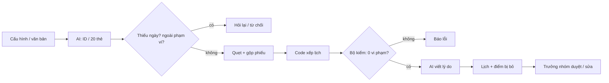

# TripSwipe — PRD

| | |
|---|---|
| **Version** | 1.0 · 28/11/2026 |
| **Target release** | MVP hackathon AI20K — CP3 10:00 (lõi + AI thật), CP4 14:30 Thứ Bảy 28/11/2026 (web) |
| **Stakeholder** | Nhóm Hihihuhu · lab coach / giám khảo AI20K |
| **Doc status** | Đã chốt qua grilling; đang triển khai |

Liên quan: [spec.md](../spec.md) (bằng chứng, chỗ khó, chuẩn "đạt") · [ARCHITECTURE.md](ARCHITECTURE.md).

---

## PROBLEM STATEMENT & BUSINESS GOALS

**Vấn đề.** Nhóm bạn đi tự túc một ngày ở Hà Nội. Một người nhận việc lên lịch: tìm và đối chiếu Google Maps, TikTok, review để chọn điểm, hỏi cả nhóm qua group chat, rồi tự xếp thứ tự. Kết quả: các điểm xa nhau, đi vòng, đến nơi đã đóng hoặc chưa mở cửa, phải bỏ điểm giữa chừng; cả nhóm khó thống nhất.

**Bằng chứng** (khảo sát đang thu, 16 phản hồi lúc 19:17 27/11; 12 người từng lên lịch cho nhóm): 9/12 gặp đi vòng / đến nơi đã đóng / bỏ lỡ địa điểm · 6/12 đến nơi đã đóng hoặc chưa mở cửa · 6/12 cả nhóm khó thống nhất · thời gian lên lịch trung vị 15–30 phút → chỗ đau là **lịch hỏng tại chỗ** và **chọn chung**, không phải thời gian ngồi lên lịch.

### Objective

1. Lịch trả ra không bao giờ đưa nhóm tới nơi đã đóng cửa vào ngày đi.
2. Cả nhóm cùng chọn điểm bằng quẹt thẻ, lịch phản ánh lựa chọn chung.
3. Lịch ít đi vòng, nằm trong khung giờ và budget nhóm đưa ra.
4. Khi không xếp được hết, người dùng biết điểm nào bị bỏ, vì sao, và nới gì để xếp được.

### User personas & Target market

**User Personas**

| Persona | Mô tả | Cần gì |
|---|---|---|
| **Trưởng nhóm (người lên lịch)** | 18–30 tuổi, được nhóm giao "lên kế hoạch" cho một ngày đi chơi nội thành Hà Nội; hiện dùng Google Maps + TikTok + group chat | Lịch đúng giờ mở cửa, ít đi vòng, có lý do để thuyết phục nhóm; duyệt được trước khi gửi |
| **Thành viên nhóm** | Bạn bè 3–6 người đi cùng | Góp ý nhanh, không phải đọc dài, không cần đăng ký |

**Target Market**

- Nhóm bạn sinh viên / người mới đi làm đi chơi tự túc một ngày ở nội thành Hà Nội (khảo sát: 7/12 người lên lịch ở nhóm 22–30 tuổi).
- MVP chỉ Hà Nội nội thành; mở rộng tỉnh khác sau khi có dữ liệu giờ mở cửa đã kiểm.

### Success metrics

**Các chỉ số đánh giá hiệu quả**

| Goal | Metric |
|---|---|
| Không đến nơi đã đóng | 100% lịch trả ra 0 vi phạm giờ mở cửa / ngày đóng / nghỉ trưa (`dung_gio_mo_cua`, kiểm bằng code) |
| Không bịa thông tin | 0 câu nêu giờ / giá / địa điểm không có trong dữ liệu (`khong_bia_du_lieu`) |
| Ít đi vòng | ≥ 80% lịch có tổng thời gian đi ≤ 1,2 × phương án ngắn nhất (`it_di_vong`) |
| Báo rõ khi không xếp được | ≥ 80% câu khó có đủ điểm bị bỏ + lý do + cách nới (`bao_ro_khi_khong_xep_duoc`) |
| Chuẩn "đạt" tổng (spec §7) | ≥ 75% câu thử qua, kèm các điều kiện cứng trên và 100% câu từ chối qua |
| Chi phí | Chi phí / task thành công tính từ token đo thật (`python run.py simulate`) |

Mức so sánh: chatbot thường không công cụ chỉ "dùng được" 5/16 câu (`eval/baseline-chatbot.md`).

---

## SYSTEM FLOW

**Use Case 1: Nhóm quẹt chọn và nhận lịch (web)**

1. Trưởng nhóm mở `localhost:9000` → **Tạo nhóm**: chọn tỉnh (chỉ Hà Nội bật), phạm vi (chỉ nội thành), ngày đi, giờ bắt đầu / kết thúc, điểm xuất phát, budget cả nhóm, phương tiện → nhận mã + link nhóm.
2. Hệ thống lọc địa điểm (nội thành, mở vào thứ của ngày đi, giao khung giờ, giá trong budget mỗi người) → AI chọn và xếp hạng 20 thẻ kèm lý do.
3. Thành viên mở link → **Vào nhóm** bằng biệt danh → **Quẹt** (thẻ tổng quan; vuốt lên xem chi tiết; phải = thích, trái = bỏ qua; hoàn tác).
4. **Phòng chờ** hiện ai đã quẹt xong (cập nhật mỗi 3 giây). Trưởng nhóm bấm **Xếp lịch** bất kỳ lúc nào.
5. Hệ thống gộp phiếu (trung bình ≥ 0,5) + điểm ghim → code xếp lịch → bộ kiểm → AI viết lý do chọn → **Lịch trình**: dòng thời gian, bản đồ, điểm bị bỏ + lý do.
6. Trưởng nhóm bỏ / ghim điểm → tính và kiểm lại (bản cũ hết hiệu lực) → duyệt → sao chép gửi nhóm.

**Use Case 2: Yêu cầu bằng văn bản (CLI / eval)**

1. Người dùng gõ: "Thứ Bảy, xuất phát Hồ Gươm, 8:00–17:00, muốn đi Văn Miếu, Hoàng thành, Hỏa Lò".
2. AI đọc → cấu hình + ID. Code: thiếu ngày đi → hỏi lại; nhiều ngày / ngoài Hà Nội → từ chối; đặt vé → từ chối phần đó; đòi bỏ giờ mở cửa → bỏ qua yêu cầu.
3. Xếp lịch → kiểm → lý do → output theo giờ + `LICH_JSON` (cho chấm bằng code).

---

## FEATURES & USER STORIES

### Danh sách chức năng chi tiết

| Mã | Chức năng | User story | Link PRD detail |
|---|---|---|---|
| TS-01 | Tạo nhóm + cấu hình | Là trưởng nhóm, tôi muốn tạo nhóm và nhập ngày, giờ, điểm xuất phát, budget, phương tiện để hệ thống chỉ gợi ý điểm hợp lệ | [TS-01](#ts-01) |
| TS-02 | Vào nhóm | Là thành viên, tôi muốn vào bằng mã + biệt danh, không đăng ký | [TS-02](#ts-02) |
| TS-03 | Bộ thẻ AI | Là cả nhóm, tôi muốn 20 thẻ hợp sở thích và đang mở vào ngày đi | [TS-03](#ts-03) |
| TS-04 | Quẹt thẻ 2 lớp | Là thành viên, tôi muốn thấy tổng quan, vuốt lên xem chi tiết, quẹt thích / bỏ qua, hoàn tác | [TS-04](#ts-04) |
| TS-05 | Phòng chờ + gộp phiếu | Là trưởng nhóm, tôi muốn thấy tiến độ và xếp lịch từ ý số đông | [TS-05](#ts-05) |
| TS-06 | Xếp lịch + kiểm | Là trưởng nhóm, tôi muốn lịch đúng giờ mở cửa, ít đi vòng, trong budget, kèm điểm bị bỏ và lý do | [TS-06](#ts-06) |
| TS-07 | Duyệt / sửa / sao chép | Là trưởng nhóm, tôi muốn bỏ / ghim điểm, duyệt và sao chép lịch | [TS-07](#ts-07) |
| TS-08 | Yêu cầu bằng văn bản | Là người chấm, tôi muốn gõ yêu cầu và nhận lịch / câu hỏi lại / lời từ chối | [TS-08](#ts-08) |

### Chi tiết chức năng

#### TS-01 · Tạo nhóm + cấu hình

| | |
|---|---|
| **User Story** | Là trưởng nhóm, tôi muốn tạo nhóm không cần tài khoản và trả lời vài câu cấu hình, để hệ thống chỉ gợi ý những điểm đi được. |
| **Jira ticket** | `.scratch/tripswipe/issues/05` (local) |
| **Design** | Wizard từng bước, giao diện máy tính |
| **Precondition** | App chạy (`docker compose up`); dữ liệu địa điểm + ma trận đã nạp |
| **Basic Flow** | 1. Chọn tỉnh → 2. Phạm vi → 3. Ngày đi → 4. Giờ bắt đầu / kết thúc → 5. Điểm xuất phát (chọn từ danh sách) → 6. Budget cả nhóm → 7. Phương tiện (xe máy / ô tô / đi bộ) → 8. Nhận mã + link |
| **Acceptance Criteria** | • Chỉ Hà Nội và nội thành bật, mục khác ghi "sắp có" · • Không cho qua bước 3 khi chưa có ngày đi · • Giờ kết thúc > giờ bắt đầu, cùng một ngày · • Mã nhóm duy nhất, 6 ký tự |
| **Corner case** | Ngày đi trong quá khứ → báo lỗi · budget 0 → chỉ gợi ý điểm miễn phí · khung giờ < 1 giờ → cảnh báo có thể không xếp được |
| **Post condition** | Nhóm ở trạng thái `swiping`; trưởng nhóm là thành viên đầu tiên (`is_leader`) |
| **Under The Hood Flow** | **Input:** form cấu hình · **Precondition:** bảng `places`, `travel_times` có dữ liệu · **Flow:** `POST /api/groups` → lưu `groups` + `members` → gọi TS-03 · **Example:** Thứ Bảy 06/12/2026, 08:00–17:00, Hồ Gươm, 1.000.000đ, xe máy → mã `HN7K2Q` |

#### TS-02 · Vào nhóm

| | |
|---|---|
| **User Story** | Là thành viên, tôi muốn mở link và nhập biệt danh là vào được nhóm. |
| **Precondition** | Nhóm tồn tại, chưa duyệt lịch |
| **Basic Flow** | 1. Mở link / nhập mã → 2. Nhập biệt danh → 3. Vào trang quẹt |
| **Acceptance Criteria** | • Không cần mật khẩu / email · • Biệt danh trùng trong nhóm thì báo đổi · • Thành viên lưu `member_id` trong trình duyệt để quay lại |
| **Corner case** | Mã sai → "Không tìm thấy nhóm" · nhóm đã duyệt lịch → chỉ xem lịch |
| **Post condition** | Có bản ghi `members`; budget mỗi người tính lại theo số thành viên |
| **Under The Hood Flow** | `POST /api/groups/{code}/members {nickname}` → `{member_id}` |

#### TS-03 · Bộ thẻ AI

| | |
|---|---|
| **User Story** | Là cả nhóm, chúng tôi muốn được gợi ý 20 điểm hợp sở thích và chắc chắn mở vào ngày đi. |
| **Precondition** | Nhóm có cấu hình đủ |
| **Basic Flow** | 1. Code lọc ứng viên → 2. AI chọn + xếp hạng 20 ID kèm lý do → 3. Lưu `deck_cards` |
| **Acceptance Criteria** | • Mọi thẻ nằm trong nội thành, mở vào thứ của ngày đi, có khung mở giao với khung giờ nhóm, giá tối đa ≤ budget mỗi người (nếu có giá) · • AI chỉ trả ID trong danh sách ứng viên; ID lạ bị loại · • Lý do không chứa số · • Có cả điểm tham quan và quán ăn |
| **Corner case** | Ít hơn 20 ứng viên → dùng hết · AI lỗi → báo lỗi, cho thử lại (không tự xếp hạng thay) |
| **Post condition** | 20 thẻ có `rank`, `ai_reason` |
| **Under The Hood Flow** | **Input:** cấu hình nhóm · **Flow:** lọc bằng `tra_gio_mo_cua` + giá → `call_model` (danh sách ứng viên id/tên/loại/tag) → validate → lưu · **Example:** Thứ Hai → không có Lăng Bác, Bảo tàng Dân tộc học, Bảo tàng Mỹ thuật |

#### TS-04 · Quẹt thẻ 2 lớp

| | |
|---|---|
| **User Story** | Là thành viên, tôi muốn chọn nhanh bằng quẹt và chỉ đọc chi tiết khi cần. |
| **Precondition** | Đã vào nhóm; bộ thẻ đã có |
| **Basic Flow** | 1. Thấy thẻ tổng quan → 2. (tuỳ chọn) vuốt lên xem chi tiết → 3. Kéo phải = thích / trái = bỏ qua, hoặc bấm nút → 4. Thẻ tiếp theo |
| **Acceptance Criteria** | • **Tổng quan:** ảnh, tên, loại, quận, câu mô tả ngắn, tag, khoảng giá, rating, "mở / đóng vào ngày đi", lý do AI · • **Chi tiết:** mô tả, vì sao nên đi, nên làm gì, giờ cả tuần, ngày đóng, thời lượng, mẹo, tóm tắt review, địa chỉ, link bản đồ, nguồn xác minh · • Hoàn tác lượt vừa rồi · • Đếm thẻ còn lại · • Thẻ thiếu giờ gắn "chưa có dữ liệu giờ" |
| **Corner case** | Ảnh lỗi / không mạng → khung ảnh trống · quẹt lại thẻ đã quẹt → ghi đè phiếu cũ (`UNIQUE(member_id, place_id)`) |
| **Post condition** | Mỗi thẻ đã quẹt có một bản ghi `swipes` |
| **Under The Hood Flow** | `GET /api/groups/{code}/deck?member_id=` · `GET /api/places/{id}` (chi tiết) · `POST /api/groups/{code}/swipes {member_id, place_id, liked}` |

#### TS-05 · Phòng chờ + gộp phiếu

| | |
|---|---|
| **User Story** | Là trưởng nhóm, tôi muốn biết ai đã quẹt xong và xếp lịch theo ý số đông. |
| **Precondition** | Có ít nhất 1 phiếu |
| **Basic Flow** | 1. Xem tiến độ (polling 3 giây) → 2. Ghim điểm bắt buộc (tuỳ chọn) → 3. Bấm "Xếp lịch" |
| **Acceptance Criteria** | • Điểm = trung bình phiếu của người đã quẹt thẻ đó (thích = 1, bỏ qua = 0) · • Vào ứng viên khi ≥ 0,5 và có ≥ 1 phiếu · • Hoà xếp theo rating · • Điểm ghim luôn là ứng viên · • Chỉ trưởng nhóm thấy nút "Xếp lịch" |
| **Corner case** | Không thẻ nào ≥ 0,5 → báo "chưa có điểm nhóm cùng thích", gợi ý quẹt thêm |
| **Post condition** | Danh sách ứng viên có điểm số |
| **Under The Hood Flow** | `GET /api/groups/{code}/progress` · `POST /api/groups/{code}/itinerary` (kiểm `is_leader`) |

#### TS-06 · Xếp lịch + kiểm

| | |
|---|---|
| **User Story** | Là trưởng nhóm, tôi muốn lịch theo giờ không đưa nhóm tới nơi đã đóng, ít đi vòng, trong budget. |
| **Precondition** | Có ứng viên (TS-05) hoặc ID từ văn bản (TS-08) |
| **Basic Flow** | 1. Tra giờ mở theo thứ / mùa → 2. Tra thời gian đi → 3. Chọn tập con + thứ tự → 4. Chèn slot ăn trưa / tối → 5. Bộ kiểm → 6. AI viết lý do → 7. Hiển thị |
| **Acceptance Criteria** | • Mỗi điểm ở trọn thời lượng trong một khung mở của đúng thứ (kể cả nghỉ trưa, giờ theo mùa của Lăng Bác) · • Không chồng giờ, đủ thời gian đi, trong khung giờ nhóm · • Ưu tiên: đủ điểm ghim → nhiều điểm được thích nhất → ít thời gian đi nhất · • Chi phí mỗi người ≤ budget mỗi người; điểm không giá ghi "chưa có giá" · • Bộ kiểm báo vi phạm → không trả lịch · • Điểm bị bỏ có lý do + ≥ 1 gợi ý nới · • Thời gian đi gắn "ước tính" · • Mọi số do code điền |
| **Corner case** | Không điểm nào vừa → chỉ trả danh sách bị bỏ + gợi ý · điểm chưa có dữ liệu giờ → xếp kèm cảnh báo, không tính là đã kiểm · quá nhiều ứng viên → dừng ở giới hạn nút tìm kiếm, lấy lịch tốt nhất đã thấy |
| **Post condition** | Bản ghi `itineraries` trạng thái `draft` |
| **Under The Hood Flow** | **Input:** ngày, khung giờ, điểm xuất phát, phương tiện, ứng viên (+ ghim, budget) · **Flow:** `tra_gio_mo_cua` → `uoc_thoi_gian_di` (ma trận OSRM, lấy max với ước tính đô thị) → vét cạn có cắt nhánh → `kiem_lich_trinh` → `call_model` (lý do, câu có số bị bỏ) · **Example:** Thứ Hai + Lăng Bác → "Lăng Chủ tịch Hồ Chí Minh: đóng cửa Thứ Hai — gợi ý đổi ngày" |

#### TS-07 · Duyệt / sửa / sao chép

| | |
|---|---|
| **User Story** | Là trưởng nhóm, tôi muốn chỉnh lịch theo ý nhóm và gửi bản cuối. |
| **Precondition** | Có lịch `draft` |
| **Basic Flow** | 1. Bỏ hoặc ghim điểm → 2. Hệ thống tính và kiểm lại → 3. Duyệt → 4. Sao chép văn bản |
| **Acceptance Criteria** | • Mỗi lần sửa tạo phiên bản mới; bản cũ `stale` · • Bản sao có giờ, tên điểm, nguồn giờ mở cửa, lời nhắc "thời gian đi là ước tính" · • Hệ thống không tự gửi lịch đi đâu |
| **Corner case** | Ghim điểm đóng vào ngày đi → báo không ghim được, nêu lý do |
| **Post condition** | Lịch `approved` |
| **Under The Hood Flow** | `PATCH /api/itineraries/{id} {action: approve | drop | pin, place_id}` |

#### TS-08 · Yêu cầu bằng văn bản

| | |
|---|---|
| **User Story** | Là người chấm, tôi muốn gõ yêu cầu và nhận lịch, câu hỏi lại hoặc lời từ chối, chạy không cần DB hay mạng. |
| **Precondition** | `python run.py` / `python run.py eval`; model thật cần API key trong file cấu hình môi trường |
| **Basic Flow** | 1. AI đọc văn bản → cấu hình + ID → 2. Code kiểm thiếu / phạm vi / cờ an toàn → 3. TS-06 → 4. Output + `LICH_JSON` |
| **Acceptance Criteria** | • Thiếu ngày đi → chỉ hỏi lại, không trả lịch · • Thiếu điểm xuất phát / khung giờ → giả định nói rõ (Hồ Gươm, 08:00–17:00) · • Nhiều ngày / ngoài Hà Nội → từ chối + đề nghị một ngày ở Hà Nội · • Đặt vé / bàn / thanh toán → từ chối phần đó, vẫn xếp lịch nếu đủ thông tin · • "Bỏ qua giờ mở cửa", "admin" → không làm theo, vẫn kiểm |
| **Corner case** | Không nhắc điểm nào → hỏi muốn đi đâu · tên điểm không có trong dữ liệu → không bịa, báo không có |
| **Post condition** | Trace ghi số lần gọi model / công cụ, token |
| **Under The Hood Flow** | **Input:** chuỗi văn bản · **Flow:** `answer(text)` → `extract` (`call_model`) → `plan` → `kiem_lich_trinh` → `reasons` (`call_model`) · **Example:** B05 "Thứ Hai… Lăng Bác, Văn Miếu, Hoàng thành" → lịch Hoàng thành + Văn Miếu; "Lăng: đóng cửa Thứ Hai" |

---

## Technical Requirements

* **Tech stack:** Python 3.12 · FastAPI + uvicorn · PostgreSQL 16 · HTML render phía server + JavaScript thuần (quẹt bằng pointer events) · Leaflet + nền OpenStreetMap · Docker Compose (`db`, `app`, cổng 9000) · lõi chỉ dùng thư viện chuẩn.
* **Key integrations:** Gemini Flash (mặc định, gói miễn phí) / Claude Haiku qua REST, token lấy từ `usage` · OSRM công cộng FOSSGIS — chỉ dùng một lần để tính ma trận, không gọi lúc chạy · dữ liệu `data/hanoi_places.json` (119 điểm, giờ đã đối chiếu nguồn chính thức).
* **Data model (Postgres):** `places` · `travel_times` · `groups` · `members` · `deck_cards` · `swipes (UNIQUE member_id, place_id)` · `itineraries (status draft | approved | stale)`.
* **API:** `GET /api/config/options` · `POST /api/groups` · `GET /api/groups/{code}` · `POST /api/groups/{code}/members` · `POST|GET /api/groups/{code}/deck` · `POST /api/groups/{code}/swipes` · `GET /api/groups/{code}/progress` · `POST /api/groups/{code}/itinerary` · `PATCH /api/itineraries/{id}` · `GET /api/places/{id}`.
* **Non-functional:** chạy hoàn toàn localhost · giao diện tiếng Việt, tối ưu máy tính · eval / CLI không cần Postgres hay internet · không lưu dữ liệu cá nhân ngoài biệt danh · API key chỉ trong file cấu hình môi trường, không commit · xếp lịch < 2 giây cho ≤ 20 ứng viên.

## Roadmap

**Phase 1 — MVP hackathon (28/11/2026)**

| Thứ tự | Việc | Mốc |
|---|---|---|
| 1 | Dữ liệu khớp nguồn chính thức, bộ kiểm lịch, ma trận OSRM, `answer(text)` với AI giả | ✅ xong |
| 2 | Nối Gemini, eval lượt 1, video CLI | CP3 10:00 |
| 3 | Web một người đi trọn luồng (docker compose, wizard, bộ thẻ, quẹt, lịch) | CP4 |
| 4 | Nhóm nhiều người, thẻ chi tiết, lịch đầy đủ (bản đồ, slot ăn, budget, sửa) | CP4 |
| 5 | Mô phỏng chi phí, eval lượt 2 | CP4 |

## Rủi ro và kế hoạch giảm thiểu

* **Dữ liệu giờ sai / cũ** → đối chiếu trang chính thức, ghi nguồn từng điểm; điểm không có nguồn → "chưa có dữ liệu giờ", không coi là đã kiểm.
* **AI bịa số hoặc ID** → AI chỉ trả ID trong danh mục, code loại ID lạ; mọi số do code điền; câu lý do có chữ số bị bỏ.
* **Thời gian đi lệch thực tế** (OSRM không tính kẹt xe) → lấy max với ước tính tốc độ đô thị, tối thiểu 5 phút, gắn "ước tính".
* **Gói miễn phí hết lượt gọi** → `--wait` giữa các câu; hỗ trợ đổi nhà cung cấp; chạy eval sớm.
* **Tấn công qua văn bản** ("bỏ qua giờ mở cửa", "admin") → cờ an toàn bằng luật cứng chồng lên model; bộ kiểm luôn chạy.
* **Thiếu thời gian build web** → lõi + eval ưu tiên trước; video CP3 quay bằng CLI.

## Out of scope

* Tài khoản đăng nhập, triển khai internet, giao diện điện thoại.
* Tỉnh khác, ngoại thành, lịch nhiều ngày, lưu trú.
* Đặt vé / bàn, giữ chỗ, thanh toán, chia tiền, tự gửi lịch ra dịch vụ ngoài.
* Dẫn đường, giao thông / thời tiết / hàng đợi thời gian thực; gọi API bản đồ lúc chạy.
* "Siêu thích", nhiều phương án lịch, WebSocket.

## Open questions

* Giờ mùa nóng của các điểm khác ngoài Lăng Bác có khác mùa lạnh không? (chưa có nguồn).
* Có cần chặng quay về điểm xuất phát cuối ngày không? (MVP: không tính).
* Video demo CP4 quay bằng web hay CLI nếu web chưa xong lúc 14:30?

## References

* Khảo sát nhóm (Google Form, 16 phản hồi tính đến 19:17 27/11/2026) · `eval/baseline-chatbot.md` · `spec.md` §1, §5, §7.
* Giờ mở cửa: bqllang.gov.vn · baotanghochiminh.vn · vanmieu.gov.vn · hoangthanhthanglong.vn · vme.org.vn · baotanglichsu.vn · hoalo.vn · vnfam.vn · baotangphunu.org.vn.
* OSRM / FOSSGIS: routing.openstreetmap.de · OpenStreetMap contributors (ODbL).
